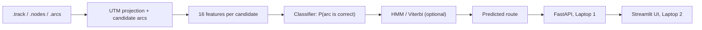

# PathSnap: distributed map-matching and route reconstruction
### Team PT066

PathSnap takes a noisy GPS trajectory and recovers the road-network route that was actually driven.
For every GPS point it generates candidate road arcs, scores each candidate with a supervised classifier,
and (optionally) decodes a connected route with an HMM/Viterbi step. The system runs as a two-laptop
client-server demo: a FastAPI backend on Laptop 1 and a Streamlit evaluator UI on Laptop 2.

Course: UE24CS352A (ML Lab hackathon)

## Team and branches

| Member | SRN | Branch | Work |
|---|---|---|---|
| Shreyashree S Rao (A) | PES1UG24AM267 | `a-data-features` | Data pipeline, EDA, candidate generation and features, Logistic Regression, Gaussian Naive Bayes, Folium maps, Streamlit UI |
| Shreya Yashodhara Singh (B) | PES1UG24AM266 | `b-eval-ui` | 15-NN baseline, evaluation harness |
| Shravani Joshi (C) | PES1UG24AM264 | `c-boost-api` | HistGradientBoosting, Optuna tuning, FastAPI backend (Laptop 1) |
| Shree Vardhan (D) | PES1UG24AM265 | `d-rf-hmm` | Road graph, Random Forest, HMM/Viterbi, `decode_route`, Folium route maps |

## How it works



1. **Preprocessing** (`src/candidates.py`): drop invalid GPS rows, sort by time, project to metres (UTM zone
   chosen from the data centre), and align the unindexed `.route` to GPS points with a monotone dynamic
   program to get a reference arc per observation.
2. **Candidates:** every arc within `RADIUS_M = 300` m of a GPS point; the nearest `MAX_CAND = 50` are kept.
3. **Features** (`FEATURE_COLS`): `dist_m`, `dist_rank`, `dist_minus_min`, `n_cand`, `is_nearest`, `proj_frac`,
   `arc_len_m`, `dist_to_end_m`, `heading_diff`, `cos_heading_diff`, `heading_valid`, `arc_bearing_sin`,
   `arc_bearing_cos`, `speed_mps`, `dt_prev`, `dt_next`. Target: `label` (1 = reference arc).
4. **Models:** Logistic Regression, Gaussian NB, 15-NN, Random Forest, HistGradientBoosting (Optuna-tuned).
5. **Sequential decoding:** HMM over candidate arcs with classifier probabilities as emissions and
   road-graph distance based transitions, decoded in log space with Viterbi.

## Data

| Partition | Trips | GPS points | Notes |
|---|---|---|---|
| `train` | 80 | 208,417 | 8.24M candidate rows (about 39.5 per point), positive-label rate 2.46% |
| `student_test` | 10 | 19,160 | used for reporting only, never for fitting or tuning |
| `evaluator_test` | 10 | reserved | read only by the API on Laptop 1, never used for training or tuning |

- Candidate miss rate (reference arc not among the candidates): 2.64% on train, 0% on student_test.
- Candidate miss rate by radius alone (train and student_test, before the 50-candidate cap):
  20 m 13.5%, 50 m 10.2%, 100 m 9.0%, 200 m 1.1%, 300 m 0.18%.
- Median distance from a GPS point to its reference arc: 5.7 m.
- Hardest trips (train): `00000033` (36.2% misses), `00000054` (13.7%), `00000002` (7.4%).

The raw data is not stored in this repository. Point `PATHSNAP_DATA` at the `Student folder`
(containing `train/` and `student_test/`), or edit `src/config.py`. Put the evaluator trips in
`data/evaluator_test/` (listed in `.gitignore`).

## Model comparison (student_test, observation-level)

Figures from the team report; Logistic Regression and Gaussian NB rows are reproducible from
`experiments/A_results.csv`.

| Model | Owner | Key configuration | CV top-1 | CV macro F1 | Test top-1 | Test macro F1 | Test log loss |
|---|---|---|---|---|---|---|---|
| Logistic Regression | A | C=1.0, L2, lbfgs, max_iter=500, StandardScaler | 0.683 | 0.799 | 78.30% | 0.836 | 0.0376 |
| Gaussian NB | A | var_smoothing=1e-9, StandardScaler | 0.490 | 0.764 | 52.50% | 0.780 | 0.3220 |
| 15-NN | B | distance-weighted, StandardScaler | 0.622 | 0.797 | 69.20% | 0.797 | N/A |
| Random Forest | D | 100 trees, depth 15, min leaf 10, sqrt features | 0.612 | 0.594 | 76.40% | 0.812 | 0.0410 |
| HistGradientBoosting | C | max_iter=100, lr=0.1, max_leaf=31 | 0.698 | 0.862 | 85.08% | 0.918 | 0.0256 |

Top-1 is computed per GPS point: the highest-scoring candidate for each `(trip_id, obs_idx)` must be the
reference arc, and points whose reference arc is not among the candidates count as wrong.
Cross-validation is grouped by trip (`GroupKFold`).

## Setup

```bash
git clone https://github.com/rao-shreyashree/pathsnap.git
cd pathsnap
python -m venv venv
venv\Scripts\activate            # Windows (source venv/bin/activate on Linux/macOS)
pip install -r requirements.txt
```

Use the **same scikit-learn version on every machine** (the models were trained with 1.9.1). Pickled
models do not reliably load across scikit-learn versions. Also keep numpy and joblib versions aligned.

## Reproduce the pipeline

```bash
python -m src.eda                  # results/eda/: trip inventory, radius sweep, plots
python -m src.build_dataset        # data/processed/{train,student_test}_{features,obs}.parquet
python -m src.train_A              # LogReg + Gaussian NB: experiments/A_results.csv, models/*.joblib
python -m src.train_A --sample-trips 8     # quick smoke test
```
The other models are in their members' branches (`b-eval-ui`, `c-boost-api`, `d-rf-hmm`), merged into `main`.
Each folder's scripts print their results to `experiments/` or `results/`.

## Folium maps

```bash
python -m src.folium_map --partition train --trip <trip_id>    # GPS, road network, reference route
python -m src.hard_trip_map                                    # trip with the most candidate misses
```

Layers: raw GPS points, road network, reference route, predicted route (pass `pred_arcs=` to
`make_map`), candidate misses with the search radius, with legend and layer control.
Maps are saved to `results/maps/`.

## Two-laptop demo

```
Laptop 1: FastAPI + models + road graph + evaluator trips   <--- HTTP --->   Laptop 2: Streamlit UI
```

**Laptop 1 (backend)**

```bash
PATHSNAP_TRACK_DIR="./data/evaluator_test" PATHSNAP_PARTITION=evaluator_test PATHSNAP_USE_HMM=0 \
  python -m uvicorn backend.main:app --host 0.0.0.0 --port 8000
```

(On Windows CMD use `set NAME=value` for each variable first.) `PATHSNAP_USE_HMM=0` serves classifier-only
predictions, which is the configuration shown in the report screenshots; `1` adds HMM decoding.
Allow port 8000 through the firewall and note the laptop's IPv4 address.

**Laptop 2 (UI)**

```bash
pip install -r ui/requirements_ui.txt
streamlit run ui/app.py            # opens http://localhost:8501
```

Copy `.streamlit/config.toml` to the repository root (dark theme), enter `http://<Laptop-1-IP>:8000` in the
sidebar and press Connect. Both laptops must be on the same network, and some campus Wi-Fi blocks
laptop-to-laptop traffic, so use a phone hotspot if the connection fails. Check
`http://<Laptop-1-IP>:8000/trips` from Laptop 2 first.

**API**

| Endpoint | Description |
|---|---|
| `GET /trips` | `{"trips": ["<trip_id>", ...]}`: the evaluation trips found in `data/evaluator_test` |
| `POST /predict` with `{"trip_id": "..."}` | predicted route as `[lat, lon]` segments, the trip's GPS points, and metrics (`n_obs`, `pointwise_accuracy`, `correct_observations`, `scored_observations`, `route_continuity`, `inference_ms`, `method`) |

Ground truth stays on the server and is never returned to the UI. The API log on Laptop 1 prints one line per
request.

## Known limitations

- The `.route` file has no per-point alignment, so the reference arc for each GPS point is derived by
  the monotone DP. It is an approximation of the ground truth, not independent ground truth.
- Keeping only the nearest 50 candidates can drop the reference arc in dense road networks; the
  miss rate is 2.64% on train, against 0.18% for the 300 m radius alone.
- Three train trips (`00000033`, `00000054`, `00000002`) have large GPS offsets or noise and dominate the
  candidate misses and the fold-to-fold variance of top-1.
- CV top-1 for Logistic Regression varies by trip (standard deviation 0.14 across folds).
